# CallBridge · VoIP calling & texting app

[](https://github.com/gayatripatel10091992/voip-callbridge/actions/workflows/ci.yml)


A second-phone-number app: Wi-Fi and mobile-data calling, SMS/MMS and group texts, voicemail with transcripts,
several numbers per device, and Google Play subscriptions sold through a **web-to-native signup funnel**.

It mirrors the kind of work I do as the sole Android developer on a 1M+ download VoIP app: subscription billing that
survives library upgrades, a WebView signup that hands over to native Play checkout, SMS Retriever OTP, deep links,
in-app updates, and call logic built to stay stable on real networks.

> Portfolio project. Original code with fictional data (555-01xx numbers); no client code, branding or APIs.

## Screenshots

Rendered on the JVM by Robolectric + Roborazzi in CI on every push, so they always match the code.

| Calls | Dark mode | Missed (grouped) | Keypad |
|---|---|---|---|
| 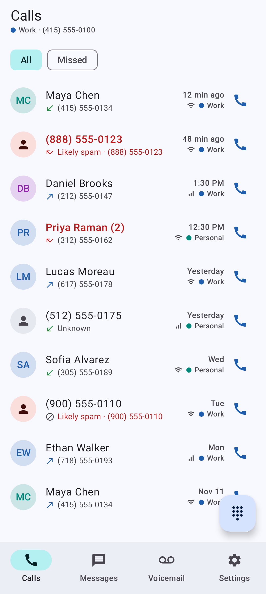 | 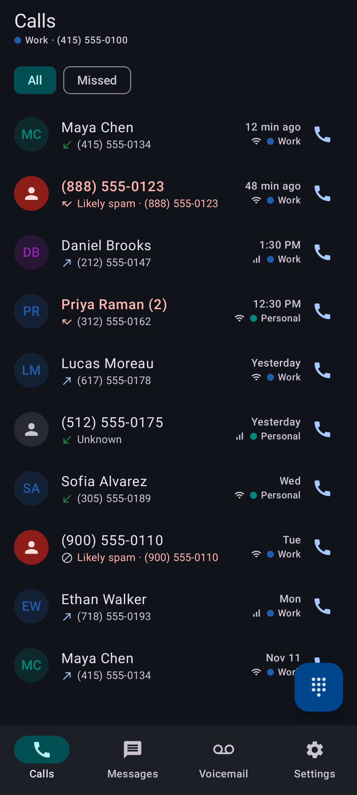 | 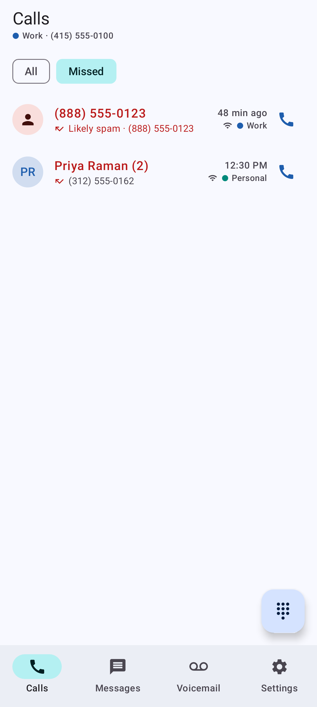 | 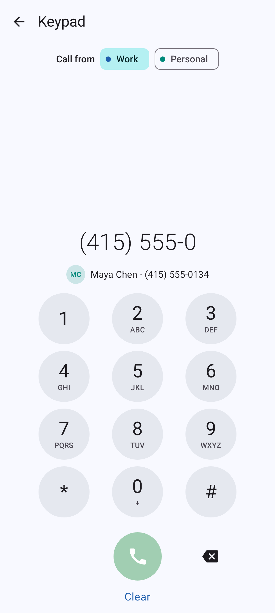 |

| In call (Wi-Fi, muted) | Network lost, reconnecting | Messages | Group MMS |
|---|---|---|---|
| 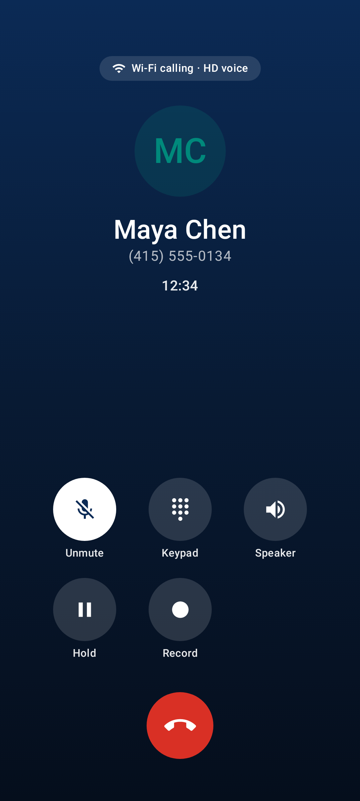 | 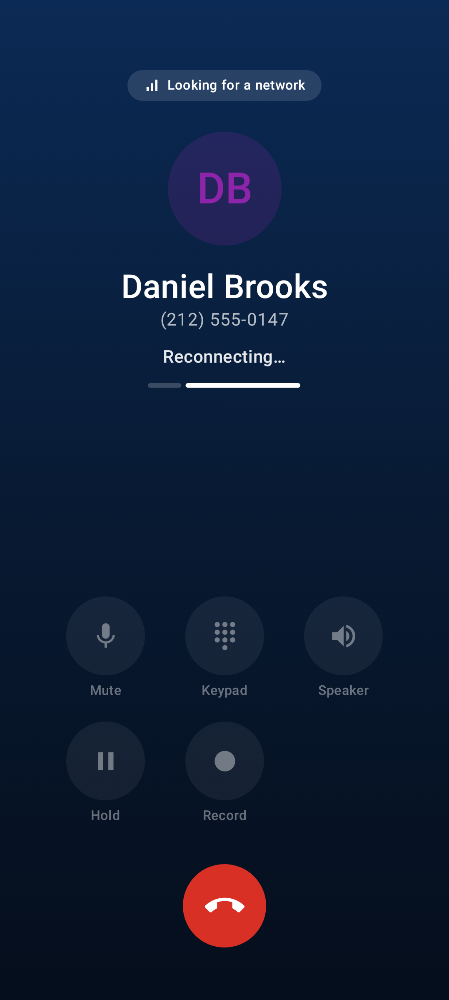 | 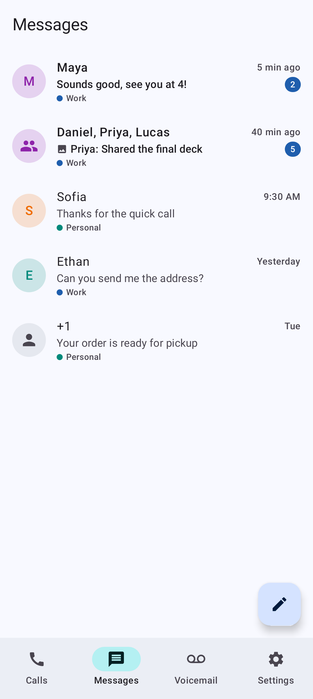 | 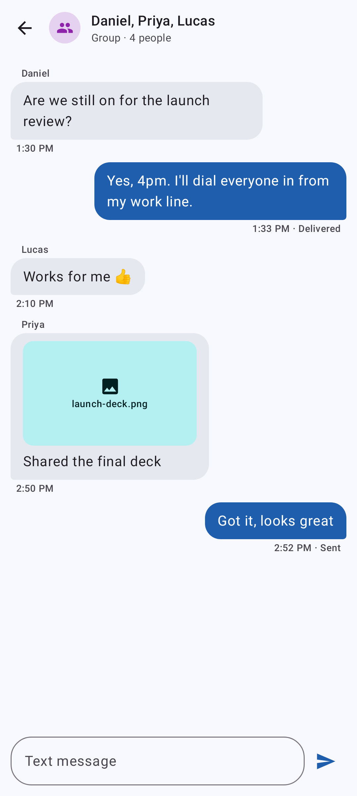 |

| Voicemail | Plans (after web signup) | Upgrade from Pro | Verify number (OTP) | Settings |
|---|---|---|---|---|
| 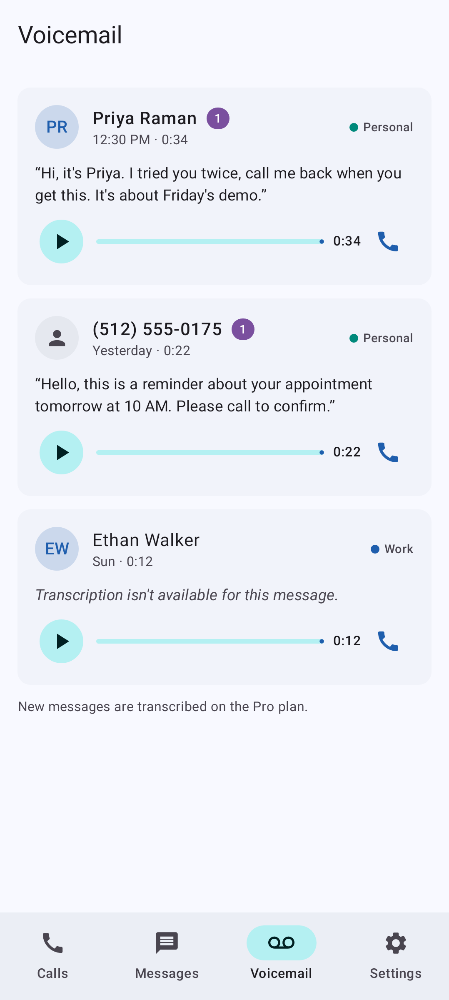 | 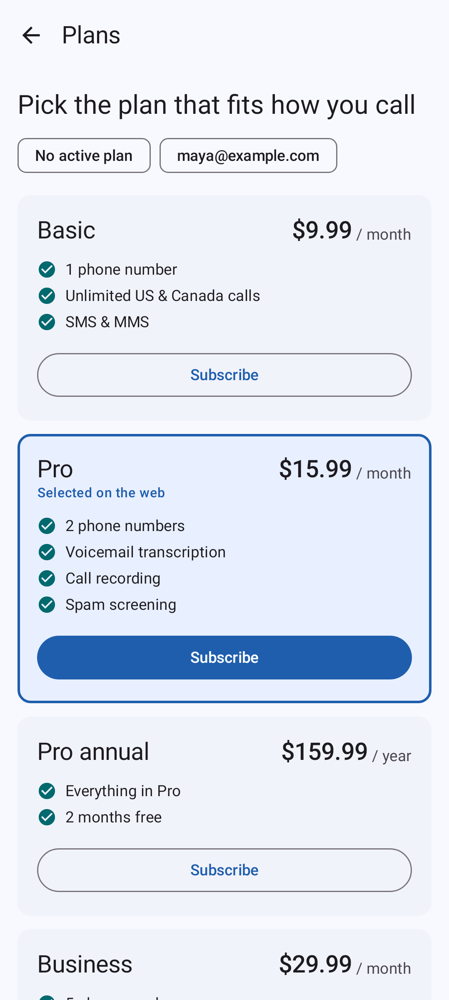 | 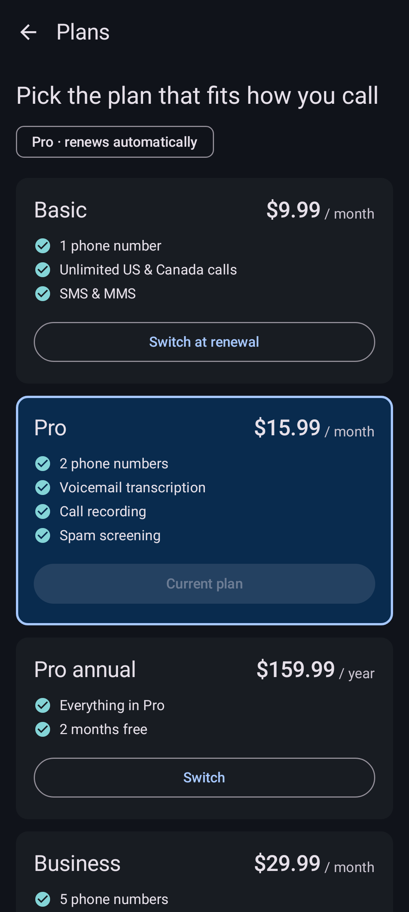 | 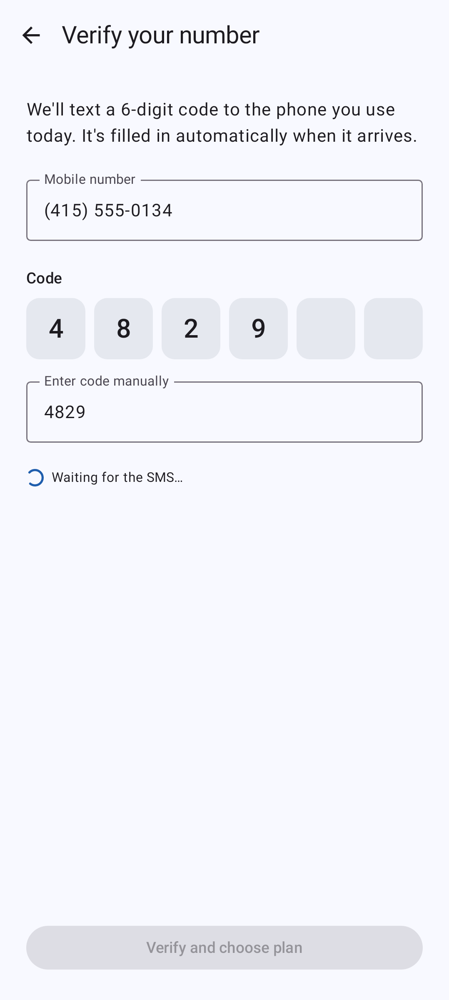 | 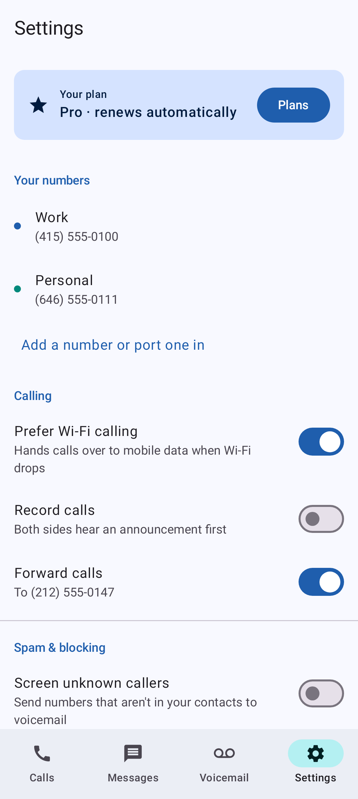 |

## Highlights

| Area | What's in the code |
|---|---|
| **Play Billing 7** | `PlayBillingGateway`: product queries, purchase restore, acknowledgement, upgrade/downgrade with `SubscriptionReplacementMode`, `obfuscatedAccountId`, pending purchases. Entitlement rules live in the pure `core` module (`EntitlementResolver`), so a billing-library upgrade only touches one class. |
| **Web → native funnel** | The signup page runs in a WebView served by `WebViewAssetLoader`. Its last step navigates to `/app/handoff?session=…&plan=…`; `HandoffParser` validates scheme, host, token format and plan before the app continues to OTP and Play checkout. Rejected handoffs never load. |
| **SMS Retriever OTP** | `SmsRetrieverEffect` registers for the one-time SMS (no SMS permission), `OtpParser` pulls the code out and verification runs automatically. |
| **Call state machine** | `CallStateMachine` is a pure reducer: dialing, ringing, active, hold/mute/speaker, **Wi-Fi ↔ mobile-data handover**, reconnecting, and a 10-second drop timeout. `NetworkMonitor` feeds real connectivity changes into it. |
| **Stability** | No disk or network work on the main thread (StrictMode in debug), lifecycle-aware collection (`collectAsStateWithLifecycle`), state survives configuration changes in view models, invalid call events are ignored instead of crashing. |
| **Calling features** | Multiple numbers per device, grouped call log, spam screening (`CallScreener`: block list with wildcards, contacts, spam score, unknown-caller screening), call forwarding, call recording setting, voicemail transcripts. |
| **Deep links & updates** | Verified App Links plus a custom scheme (`DeepLinkParser` rejects foreign hosts and unsafe ids); flexible Play in-app updates. |
| **Release** | targetSdk 35, edge-to-edge, R8 with resource shrinking, CI builds debug and release APKs. |

## Architecture

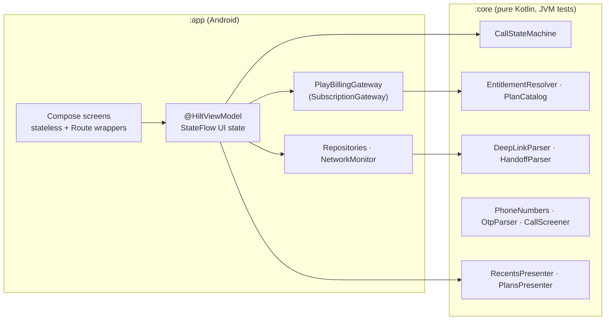

Every screen is split into a `…Route` (gets the view model from Hilt) and a stateless `…Screen(state, callbacks)`,
which is what the screenshot tests render.

## Try the funnel

Settings › *Create an account on the web* › pick a plan › **Continue in the app** → verify your number → Plans opens with the
web plan highlighted. On a device without Google Play the paywall still renders with fallback prices and explains why checkout can't open.

## Build

```bash
./gradlew :core:test                 # 22 JVM unit tests: state machine, billing rules, links, OTP, screening
./gradlew :app:recordRoborazziDebug  # renders the screenshots above
./gradlew assembleDebug
```

Requires JDK 17. Real Play Billing needs the app uploaded to a Play Console testing track with the four subscription
product ids from `PlanCatalog`.

## License

MIT
